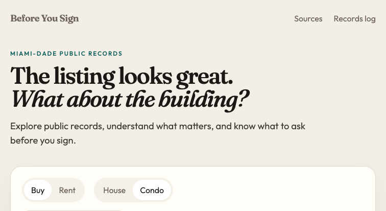
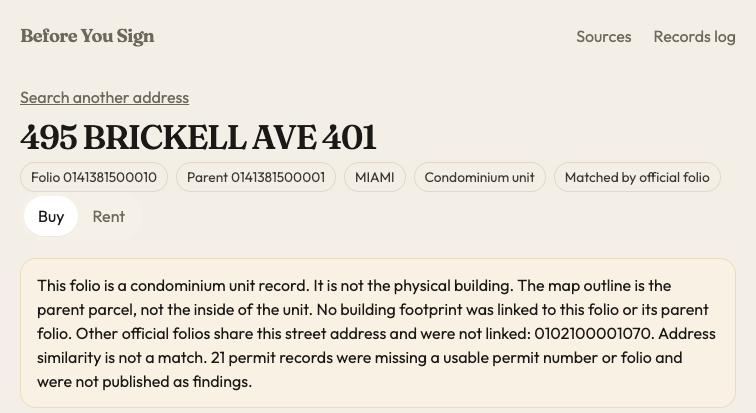

# Before You Sign

Before You Sign helps someone investigate a Miami-Dade property before they rent or buy it. It reads official public records, keeps the folio that those records actually use, and says when a source was not searched.

It is not a listing site, not a safety score, and not a legal opinion.

## What you can do locally

Search a Miami-Dade address. Open a property. See the official folio, the municipality from the county boundary layer, City of Miami permits when the point is inside the city, and the FEMA flood zone at that point. Open the source record. Copy a checklist. Ask a question that is answered only from those records, or refused when the records are not there.

Three properties were loaded from the live services on 23 November 2026:

| Address | Folio | What it shows |
|---|---|---|
| 495 Brickell Ave 401 | `0141381500010` | City of Miami condominium unit. Two permits on the unit folio. Parent-parcel permits kept separate. A commercial folio at the same street was not linked. Flood zone AE. |
| 3598 Avocado Ave | `0141210131000` | City of Miami house. Permit `PZ-22-14707-WA`, status Approved. Flood zone X. |
| 1 Alhambra Cir 201 | `0341080770010` | Coral Gables condominium unit. City of Miami permits were not searched. |

## Run it

From `/Users/offamacbook/Projects/before-you-sign`:

```bash
docker compose up -d
uv sync --project backend
uv run --project backend alembic upgrade head
uv run --project backend python -m bys.cli seed
uv run --project backend uvicorn bys.api.app:app --host 127.0.0.1 --port 8000
```

In another terminal:

```bash
npm --prefix apps/web install
npm --prefix apps/web run dev -- --host 127.0.0.1 --port 5173
```

Open http://127.0.0.1:5173/





PostGIS is on port 5433. Port 5432 is already used by another Postgres on this machine and is left alone. The local database password in `compose.yaml` is `bys`. It is a development default, not a production secret.

## How the data is kept

Official responses are stored unchanged under `data/bronze/`. DuckDB writes a Parquet split of valid and rejected permit rows under `data/silver/`. PostgreSQL/PostGIS is the serving database. A changed permit payload gets a new row in `evidence.permit_versions`. A record with no permit number is held in `ops.rejected_records` and is not shown as a finding.

The app does not load the whole county. The property-appraiser point layer has about 944,000 records. Search hits that service live. A report fetches the folio you opened.

## What it does not do

- It does not search City of Miami permits outside the city.
- It does not include code enforcement, 311, association budgets, or reserve studies.
- It does not treat a missing record as a clean building.
- It does not show a flood-zone polygon on the map. The zone comes from a point query. The outline on the map is the parcel.
- It does not use a language model unless `BYS_USE_OLLAMA=1`. Answers are assembled from the findings on the page. Unsupported questions are refused.
- Private document upload is not enabled.

## Tests

```bash
uv run --project backend pytest -q
npm --prefix apps/web run build
```

## Sources

See `docs/source-contracts.md`. County parcel and building layers, municipal boundaries, City of Miami permits, and the county copy of FEMA flood zones. The national NFHL host at `hazards.fema.gov` reset the connection from this machine on 23 November 2026, so it is not a live dependency.

The report map is Esri World Imagery, with Esri, Maxar, and Earthstar Geographics named on the map. The gold line is the parcel or parent parcel from the property appraiser, not a flood shape.
