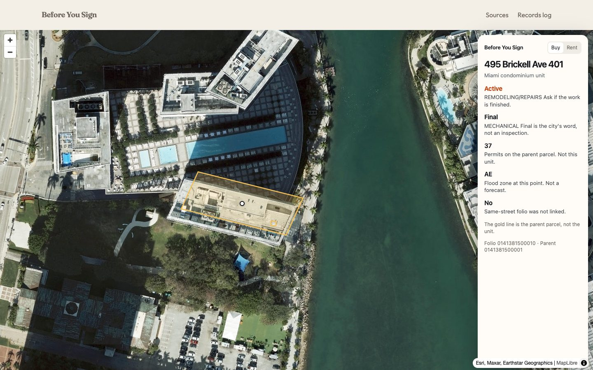

# Before You Sign

The listing looks great. What about the building?

Before You Sign is a briefing for a Miami-Dade property before you rent or buy it. It finds the official folio, shows the public records that belong to that folio, and leaves out the ones that do not.



This is unit 401 at 495 Brickell Ave, opened in the app. The photograph is Esri World Imagery. The gold line is the county parent parcel, not the inside of the unit. The sheet is what those records say.

## What it is meant to be

A person should be able to open an address and leave with three things: the right property, the records that can be checked, and the questions still worth asking. Every finding should open back to the government record. A missing source should stay missing.

It is not a listing site, not a safety score, and not a legal opinion.

The aim is the same briefing for more municipalities, and later for documents the user brings, such as an inspection report or an association budget, with answers that cite the page they came from. That document search is not built.

## What is real

These records were loaded from the live county and city services on 23 November 2026.

- The unit has an Active remodel permit. The app tells you to ask if the work is finished. Active is not treated as done.
- A second permit on the unit is Final. That is the city's word, not an inspection.
- 37 other permits are on the parent parcel. They are not presented as this unit's.
- A commercial folio at the same street number was refused. The same address is not a match.
- Flood zone AE is the map class at this point. No flood shape is drawn. It is not a forecast.
- Click a row and the source record is there.

The same rules show their limits on two other loaded properties.

| Address | Folio | What it shows |
|---|---|---|
| 3598 Avocado Ave | `0141210131000` | A Miami house. Permit `PZ-22-14707-WA`, status Approved. Zone X, which is not a promise the house will not flood. |
| 1 Alhambra Cir 201 | `0341080770010` | A Coral Gables unit. City of Miami permits were not searched. That is not a clean building. |

## How the records are kept

Official responses are stored unchanged under `data/bronze/`. DuckDB writes valid rows and holds back bad ones under `data/silver/`. PostgreSQL/PostGIS serves the report. A changed permit becomes a new row in `evidence.permit_versions`. A record with no permit number is held in `ops.rejected_records` and is not shown as a finding.

The property-appraiser point layer has about 944,000 records. The app does not copy the county. Search asks that service live. A report fetches the folio you opened.

## What it does not do

- It does not search City of Miami permits outside the city.
- It does not include code enforcement, 311, association budgets, or reserve studies.
- It does not treat a missing record as a clean building.
- It does not draw a flood-zone polygon. The zone comes from a point query. The gold line is the parcel.
- It does not use a language model unless `BYS_USE_OLLAMA=1`. Answers are assembled from the findings, or refused.
- Private document upload is not enabled.

## Run it

From the repository root:

```bash
docker compose up -d
uv sync --project backend
uv run --project backend alembic upgrade head
uv run --project backend python -m bys.cli seed
uv run --project backend uvicorn bys.api.app:app --host 127.0.0.1 --port 8000
```

In another terminal:

```bash
npm --prefix apps/web install
npm --prefix apps/web run dev -- --host 127.0.0.1 --port 5173
```

Open http://127.0.0.1:5173/ and search `495 Brickell`. Pick folio `0141381500010`, not `0102100001070`.

PostGIS is on port 5433. Port 5432 is left alone. The local database password in `compose.yaml` is `bys`. It is a development default, not a production secret.

## Tests

```bash
uv run --project backend pytest -q
npm --prefix apps/web run build
```

## Sources

See `docs/source-contracts.md`. County parcel and building layers, municipal boundaries, City of Miami permits, and the county copy of FEMA flood zones. The national NFHL host at `hazards.fema.gov` reset the connection from this machine on 23 November 2026, so it is not a live dependency.

Map attribution on the photograph: Esri, Maxar, Earthstar Geographics.
